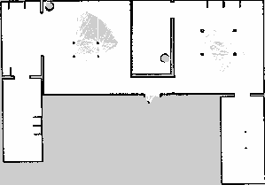
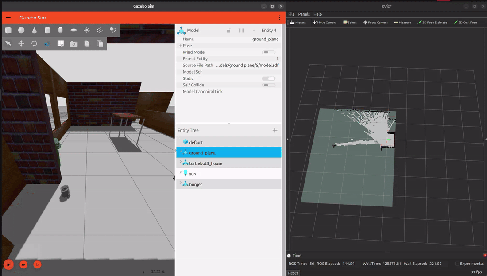

# TurtleBot3 SLAM and Obstacle Avoidance (ROS 2 Lyrical + Gazebo)

A simulation project where a TurtleBot3 Burger is driven by my own ROS 2 nodes
in a Gazebo house world, and a floor-plan map is built with `slam_toolbox`.




## What it does
- **circle_driver**: publishes `TwistStamped` velocity commands on `/cmd_vel`
- **odom_listener**: subscribes to `/odom` and logs the robot's x/y position
- **obstacle_avoider**: reads the LiDAR (`/scan`), finds the closest obstacle in
  front/left/right sectors, and steers toward free space (with hysteresis to
  prevent left/right dithering)
- **SLAM**: `slam_toolbox` (online async) builds the map; saved with `nav2_map_server`

## Architecture
`/scan` and `/odom` come from Gazebo through `ros_gz_bridge`. My nodes publish
`/cmd_vel`, and `slam_toolbox` publishes `/map` and the `map -> odom` transform.

## Environment
| Component | Version |
|---|---|
| OS | Ubuntu 26.04.1 LTS |
| ROS 2 | Lyrical Luth |
| Gazebo Sim | 10.5.0 (Jetty) |
| Python | 3.14.4 |
| slam_toolbox | 2.10.0 |
| turtlebot3_gazebo | 2.3.7 (Burger model) |
| ros_gz_sim | 3.0.10 |
| RViz2 | 15.2.6 |
| nav2_map_server | 1.5.2 |

## Run it
```bash
cd ~/ros2_ws && colcon build --symlink-install && source install/setup.bash
export TURTLEBOT3_MODEL=burger
ros2 launch turtlebot3_gazebo turtlebot3_house.launch.py x_pose:=-5.65 y_pose:=4.81   # terminal 1
ros2 launch slam_toolbox online_async_launch.py use_sim_time:=true                   # terminal 2
ros2 run rviz2 rviz2 --ros-args -p use_sim_time:=true                                # terminal 3
ros2 run my_first_pkg obstacle_avoider                                               # terminal 4
```
Save the map: `ros2 run nav2_map_server map_saver_cli -f maps/house_map`

## Result
Map of about 15 m x 10.5 m at 5 cm/pixel (`maps/house_map.pgm` / `.yaml`).

## What I learned
- The TurtleBot3 sim here expects `TwistStamped` on `/cmd_vel`, not `Twist`. I
  found this by inspecting the topic type before writing code.
- A reactive controller with no memory dithers in corridors. Adding a turn
  direction state with two thresholds (0.5 m to start turning, 0.8 m to stop) fixed it.
- Commanding 1.0 m/s on a robot rated for about 0.22 m/s flipped it in simulation and
  produced a ghosted SLAM map. Staying within the speed limit gave a clean map.
- - The simulation ran at roughly a third of real time (31-33% real-time factor) on my
  laptop with the full stack running, so mapping the house took longer than expected.
## Next steps
Autonomous navigation with Nav2 (component packages are installed, but
`nav2_bringup` was not yet available for Lyrical), and a hardware version
with an ESP32 and micro-ROS.